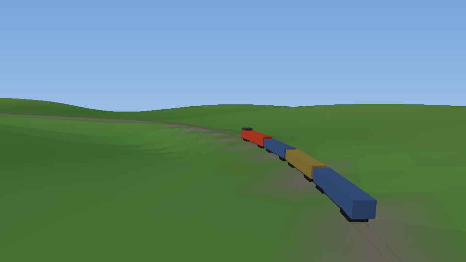

# The engine's own parts, and a test world

> **Goal, clarified by the owner (2026-11-12):** an OpenMW-style remake: **our engine
> playing the original TS2010 files** from the install (read only). See [PLAN.md](PLAN.md).
> This page covers the engine parts that are our own code (simulation, driving) and
> `drive-demo`, a small generated test world for them that needs no game files. Content for the
> real game comes from the original files, not from here.

## What carries over

Everything below is the port's own code, written for this project, and works without game files:

| Part | Where | State |
|---|---|---|
| Software 3D renderer (textures, cut-outs, mips) | `src/view/SceneRender` | working |
| Track geometry: curves through vertices, straight pieces, junction sides | `src/content/TrackLayout` (`trackCurve`, `TrackLocator`) | working (the data structures are general) |
| Vehicles on track: bogie placement, tilt | `src/view/RouteScene` (`placeOnBogies`) | working |
| Fly camera, keyboard / mouse / gamepad | `src/view/FlyCamera`, `src/input` | working |
| Window, launcher, packaging | `tools/viewer`, `tools/launcher`, CPack | working |
| **Simulation core**: driving along track, train physics | `src/sim` | working, tested |
| **First generated world and driving** | `src/game`, `tools/game/drive_demo.cpp` | **started**: runs with no game files |

## Milestones

1. **Simulation core** (started): a position on the track that drives forward and back across
   vertices and junctions (`sim::TrackNetwork`), and train physics (`sim::stepTrain`: traction
   limited by force and power, brakes, Davis resistance, gradients). Tested without any files.
2. **A first drivable world, generated** (started): `drive-demo` makes gentle hills, a 2.1 km
   oval with a turnout into a buffered siding, and a box locomotive with three wagons on
   bogies, all by code; drive it with throttle, brake, reverser and the turnout switch, behind
   a chase camera. **It runs with no TS2010 files at all** (CTest `DriveDemo.Cli` runs it from
   an empty folder). Still to come here: better models, a cab view, speed limits.

   

   `drive-demo` keys: W/S or Up/Down throttle, Space (held) brake, R reverser (when stopped),
   J turnout (main line / siding), C chase or free camera (free: the route-viewer keys), Esc quit.
   ("drive-demo" is a working name; the game's name is the owner's to pick.)
3. **Our own content formats**: a plain, documented file format for routes and trains, and
   a way to save the generated world.
4. **Driver view and controls**: cab or chase camera, speedometer, simple HUD.
5. **Signals and rules**: blocks, signals, speed limits.
6. **Scenarios**: a start position, goals (deliver, reach a station on time), save/load.
7. **Sound**: our own or freely licensed engine and wheel sounds.
8. **A track editor**: lay track on the terrain.

Packaging is shared with the port: [`PACKAGING.md`](PACKAGING.md).
