# Screenshots

Made on 2026-11-11 by the port's own command-line tools from the TS2010 disc content
(read-only), then shrunk and recompressed. These images come from N3V's copyrighted
content in Dad's own copy, so they belong in this **private** repository only.

None of these is the game running: there is no playable build yet. They show what the
port can already read and draw.

| Image | What it is | Made with |
|---|---|---|
| 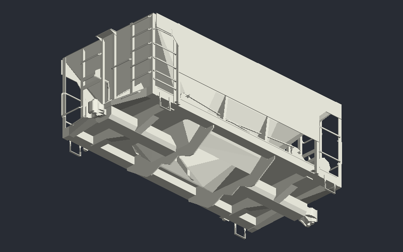 | 70-ton ore car body, a `.im` mesh, flat-shaded (no textures in this preview) | `mesh-tool preview … --view 3q` |
| 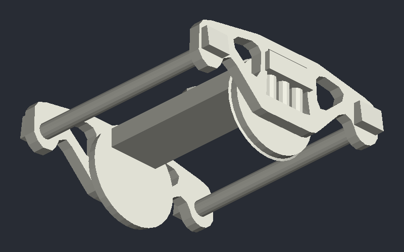 | `benthd.pm`, an older `.pm` mesh (a bogie) | `mesh-tool preview … --view 3q` |
| 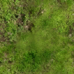 | `grass_15.texture` (`MMTF` → RGBA) | `texture-tool png` |
| 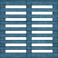 | A crate built from a `.texture.txt` descriptor: colour TGA + separate grey alpha mask (see-through slats) | `texture-tool png` |
| 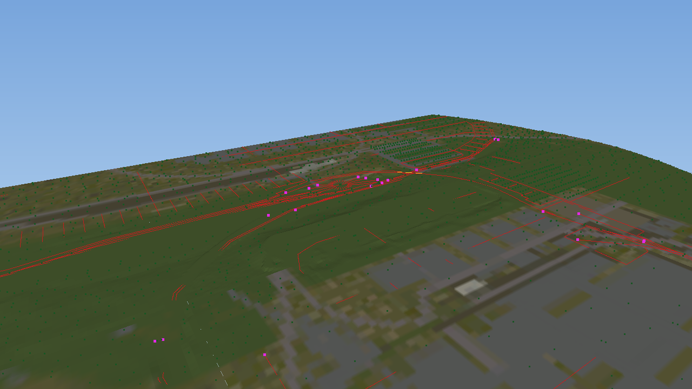 | **3D view** of the test route: terrain coloured from its overview maps (the grey strip is the airport runway), track, signals (magenta) and trees (green). Rendered by the port's own software renderer from decoded data; no models or textures yet | `route-tool view` |
| 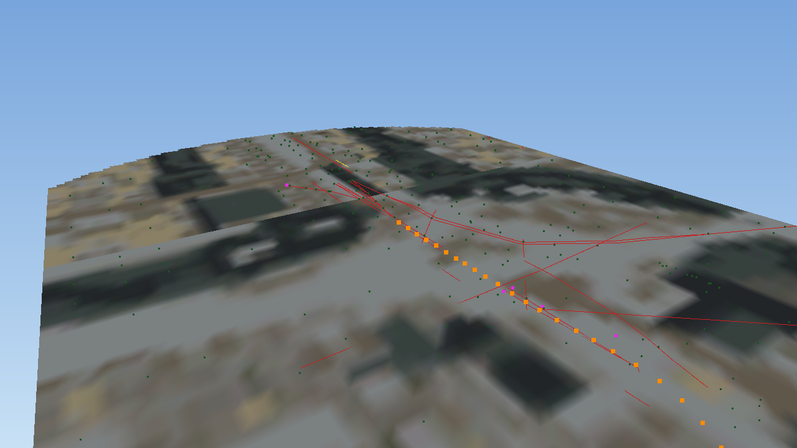 | **3D view** of "Midday Manifest": one of its trains (orange) on its track through a town. Vehicles are drawn at their track piece's height, a preview approximation, not a decoded vehicle elevation | `route-tool view … --session … --radius 500` |
| 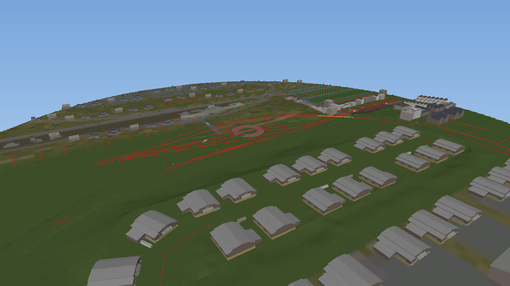 | **3D view with models** (`--install`): the test route's houses, yard turntable and buildings drawn as their real 3D models from the disc (856 objects, trees included, after the bare-number KUID fix). Preview limits: one flat colour per part (the average of its texture); full-detail daytime parts only; parts on attachment points (e.g. doors) are left out | `route-tool view … --install …` |
| 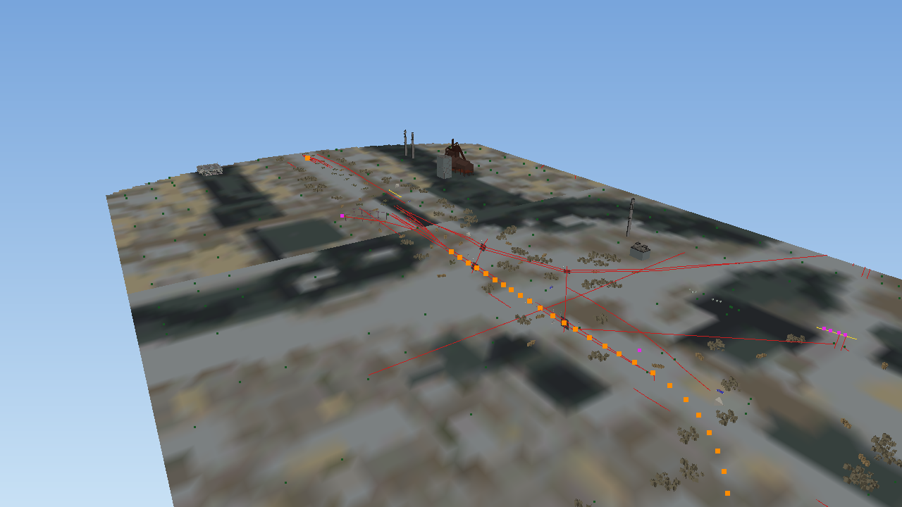 | "Midday Manifest" with models: bushes, poles and an industrial structure along the line, the train in orange | `route-tool view … --session … --install …` |
|  | **Trains as models**: "Midday Manifest" close-up (250 m) with 15 vehicles drawn as their 3D models along the track (8 through a reskin's base asset, 3 through a `.lm.txt`). Preview limits: flat colours, no bogies, front/back unknown, height approximated from the track | `route-tool view … --session … --install … --radius 250` |
|  | **3D view** of the "Thüringen Romantik Strecke" station area (500 m): station buildings, platforms and track in a valley, wooded hills; 1,718 objects drawn as their models. Same preview limits (flat colours, straight track) | `route-tool view … --install … --radius 500` |
| 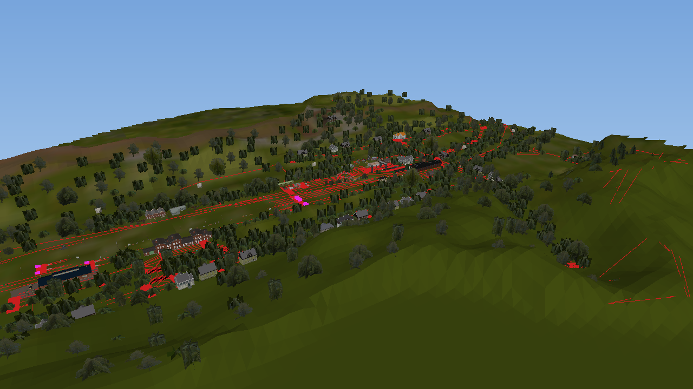 | **Textured models**: the same Thüringen view with each part's own texture (perspective-correct, the file's mips picked by on-screen size). Billboard trees show their leaves as cut-outs; houses show walls and roofs. Preview limits: the cut-out test is a heuristic (≥5% clear, ≥1% solid, <50% in between), no lighting maps or blending, terrain still coloured from the overview maps | `route-tool view … --install … --radius 500` |
| 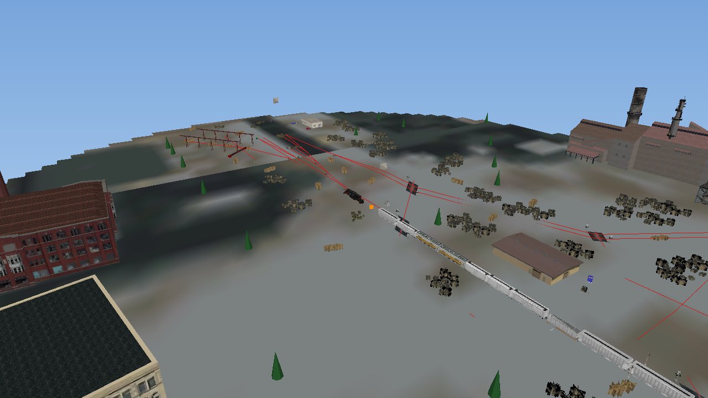 | "Midday Manifest" close-up, textured: brick buildings with windows, the train's cars, the industrial plant. The dark bushes are dark in their own texture (how the game lights them is not known) | `route-tool view … --session … --install … --radius 250` |
| 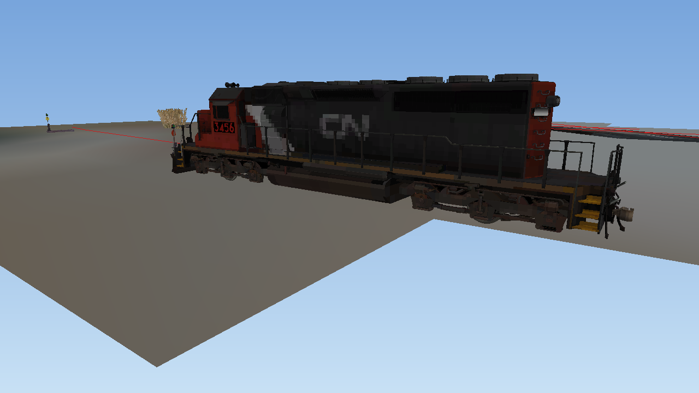 | **Bogies and attached parts**: the CN SD40-2 in "Midday Manifest" on its two trucks, read from its `bogeys` list and hung on the body's `a.bog0`/`a.bog1` attachment points (`ATCH`, decoded); handrails, fans and steps. Close camera with `--eye`. Preview limits: bogies don't turn on curves; the point-to-entry match is documented in the Trainz wiki, not traced | `route-tool view … --session … --install … --radius 60 --eye -14 -10 4` |
| 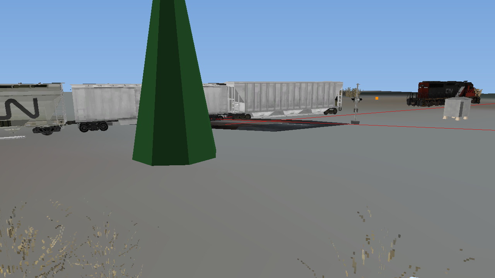 | The same train's covered hoppers and boxcars, each on its own bogies (a bare-number `bogey`, e.g. `100008` = `<kuid:-1:100008>`, whose model exists only as a `.pm`). Grass in front drawn as cut-outs; the green cone is a SpeedTree **placeholder** | `route-tool view … --radius 120 --at 352 -3745 --eye 22 -12 5` |
| 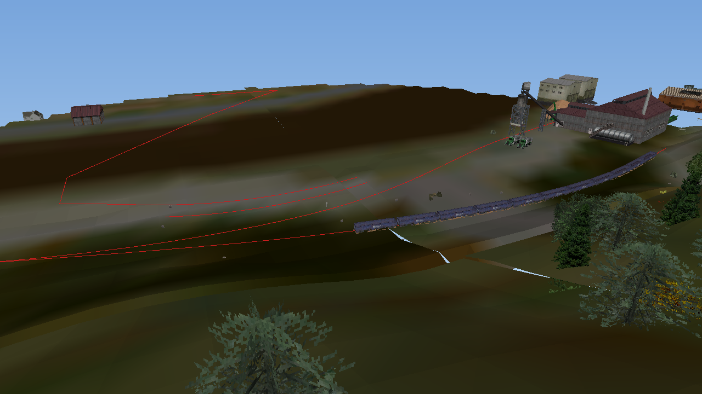 | **Curved track**: a woodchip train on a 252 m curved siding (Builtin `2.ja` route `<kuid:47119:1015>`), the red track drawn with the port's curve model and the cars and bogies turned to it, which puts 97% of disc session vehicles within 0.5 m of their track (87% for straight lines). A model checked against the data, not traced | `route-tool view … --session … --install … --radius 220 --at -5760 -2090 --eye -60 -140 70` |
| 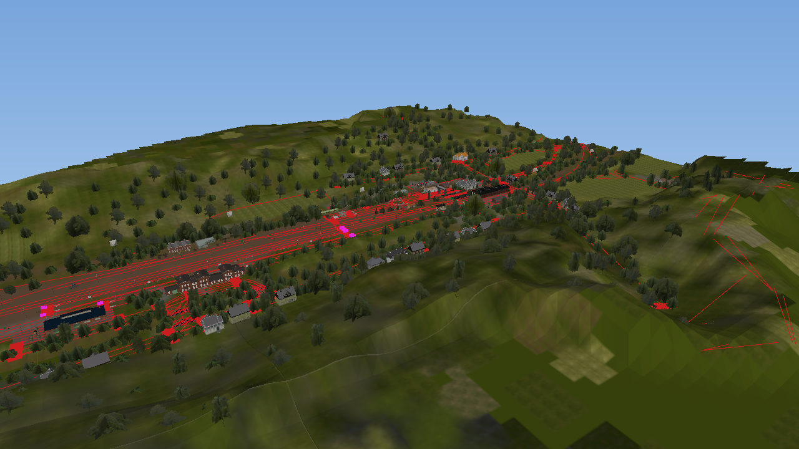 | **Ground textures**: Thüringen with each terrain section's own ground-texture blend (grass, fields, the gravel station area) instead of overview colours. The vertex layers and weights are decoded; the 10 m repeat size is an **assumption** | `route-tool view … --install … --radius 500` |
| 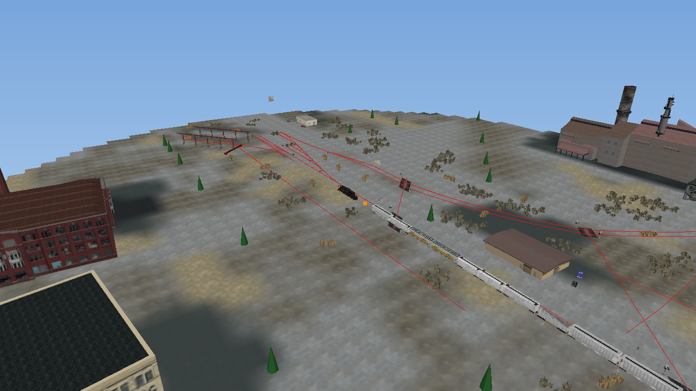 | "Midday Manifest" with its ground: gravel, sand and dark yard ground around the train | `route-tool view … --session … --install … --radius 250` |
| 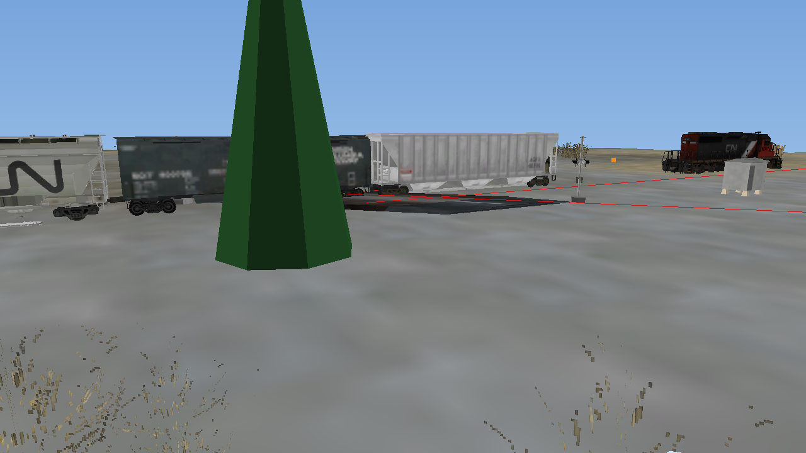 | **Reskin paint**: the Midday Manifest boxcars and hoppers that are Paint Shed reskins now show their own paint and lettering (dark green "SOT" boxcar, ACFX hopper) instead of their base model's | `route-tool view … --radius 120 --at 352 -3745 --eye 22 -12 5` |
| 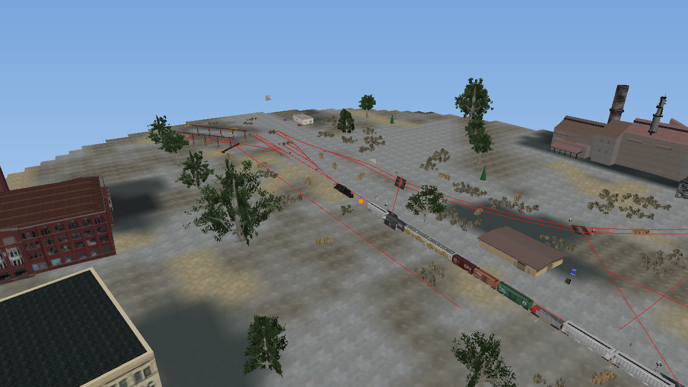 | **SpeedTree trees as billboards**: the Midday Manifest trees (maples, beeches, broadleaf) drawn as crossed cut-out pictures from their own billboard atlases, sized by the `.srt` header box and `mesh-scale`, instead of placeholder cones. Not their 3D shape | `route-tool view … --session … --install … --radius 250` |
| 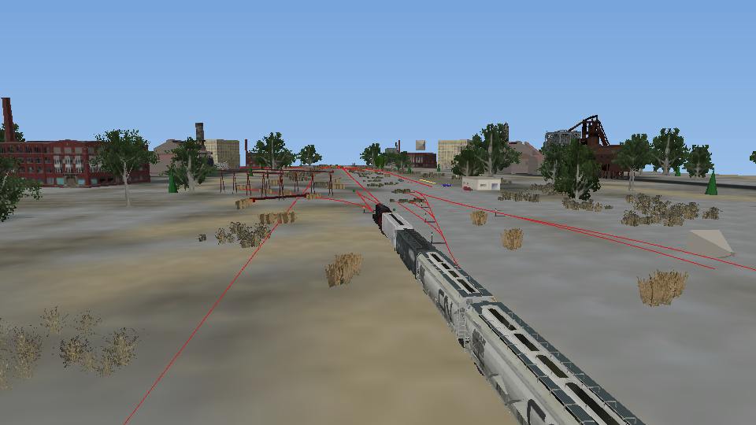 | **Driving a session's train on its route**: Midday Manifest's first train (31 vehicles, each its own model on its own bogies) under way on its route, chase camera; `route-viewer --drive` | `route-viewer --install … --session "Midday Manifest" --drive` |
| 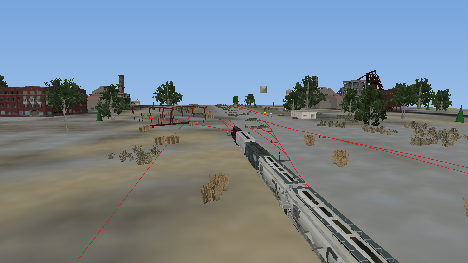 | **Driving into the yard**: the same train at 37 km/h at the top notch, about to run through a junction set as the route stores it; signal lamps lit ahead (the port's own block rules) | `route-viewer --install … --session "Midday Manifest" --drive --frames 30 --png` |
| 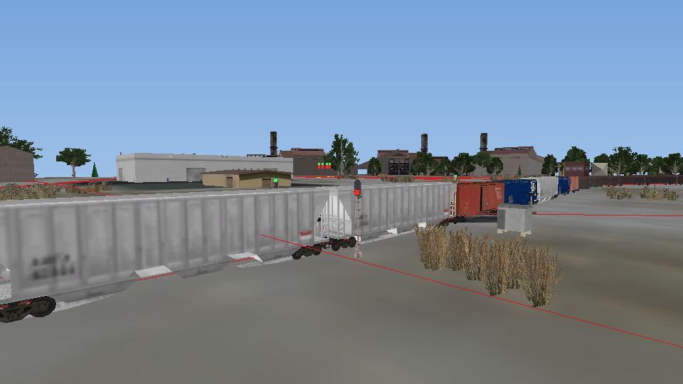 | **A signal at stop**: the three-lamp signal `<kuid2:45324:24000:1>` shows its red lamp (from its own `signals`/`lights` config and `a.light` points) because a standing hopper train is in its block; signal turned to face along its track (a guess) | `route-viewer --install … --session "Midday Manifest" --at 338 -3869 --camera 322 -3852 6 338.2 -3868.9 4.5 --frames 1 --png` |
| 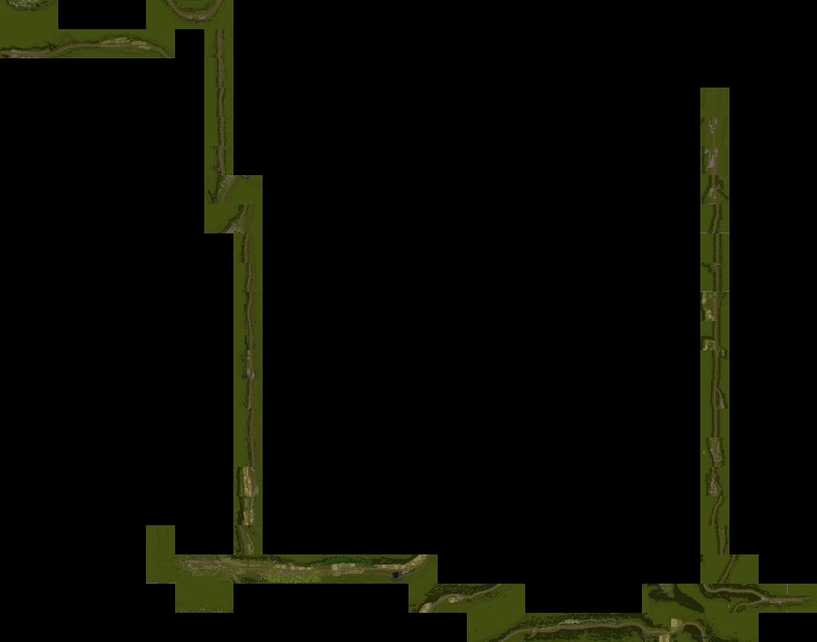 | "Thüringen Romantik Strecke": every terrain section's built-in 64×64 overview map, stitched | `route-tool overview` |
| 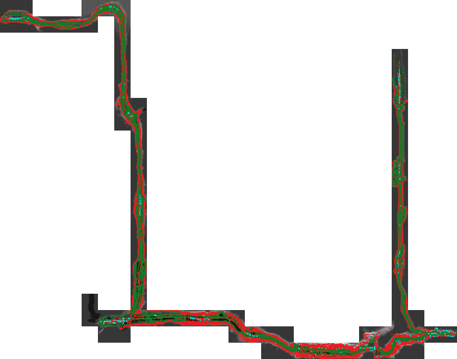 | The same route: terrain heights (black low, white high), placed objects (green) and the track network on top | `route-tool track` |
| 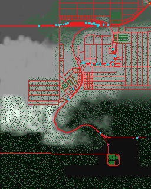 | The test route with its 10,201 placed objects (dark green dots; signals magenta) under the track | `route-tool track` |
| 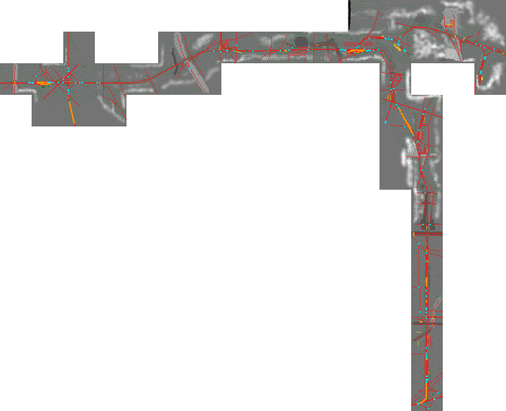 | The "Midday Manifest" session's 25 trains (231 vehicles, orange) on its route `<kuid:107727:1019>`, with track, junctions and objects | `route-tool track … --session …` |
| 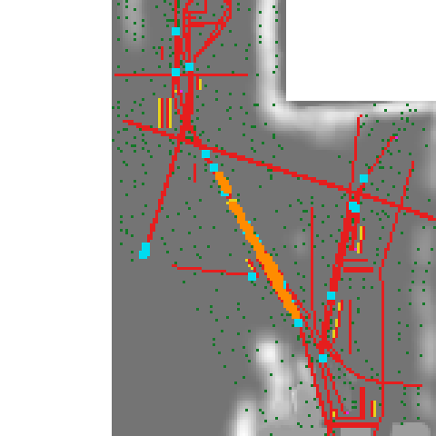 | Close-up (3×) of the busiest yard: a long train sitting on its track line | `route-tool track … --session …`, cropped |
| 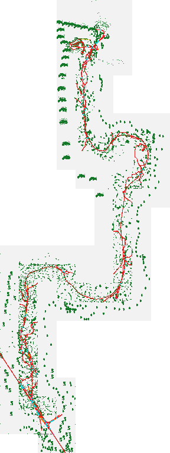 | An older (version-1) session, "Frühdienst Teil 2", on its route "Winter in Deutschland": 12 trains, 33 vehicles (orange, small at this scale) | `route-tool track … --session …` |
| 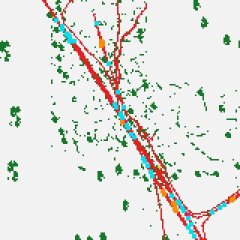 | Close-up (3×) of its busiest area: vehicles on their track lines around junctions. Old-layout trains are found by a pattern (see session.md) | `route-tool track … --session …`, cropped |
| 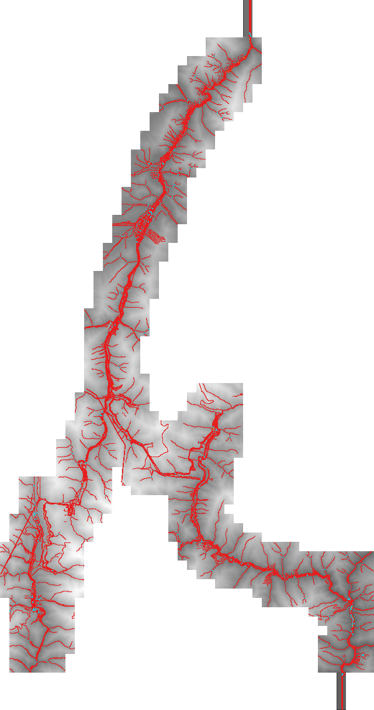 | "Avery – Drexel", the disc's largest route that fits one image (30,169 spline pieces) | `route-tool track` |

In the track maps, **red** is every `tkSt` spline piece, which seems to include roads
and other splines as well as railway (not confirmed); **yellow** is `tkBr`; **cyan**
marks vertices where 3 or more pieces meet (likely junctions). Pieces follow the
port's curve model (see [route-objects.md](../formats/route-objects.md)); pictures made
before it show straight lines between vertices. Terrain
seams that remain are real mismatches in the data (unexplained; see
[route.md](../formats/route.md)). The largest disc route, "ECML Kings Cross – York", is
too big for one image (over 8,192 pixels across).
